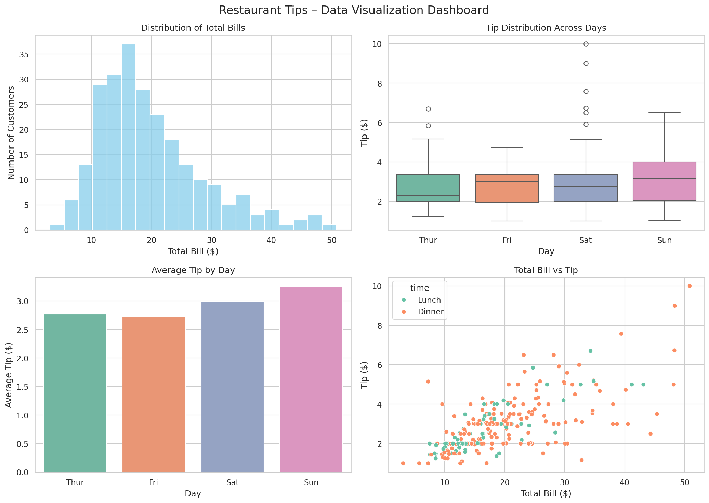
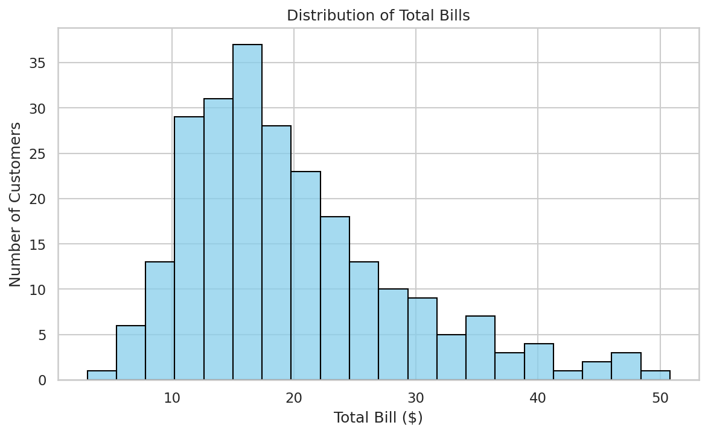
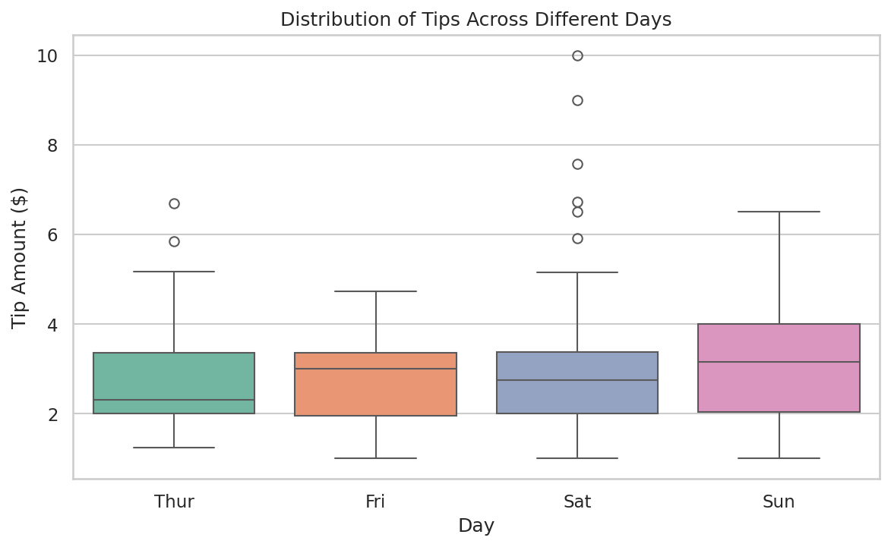
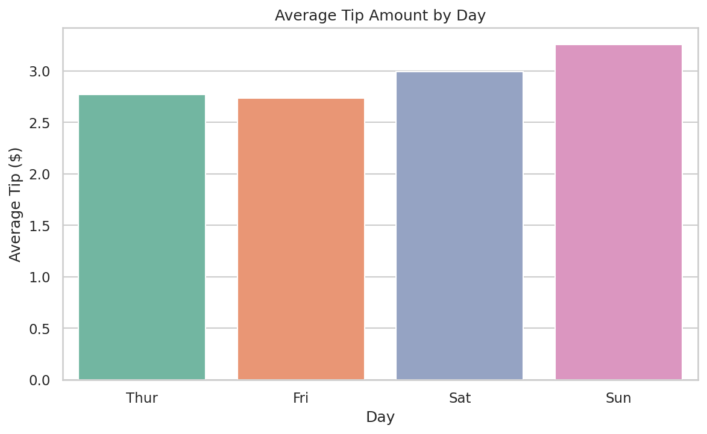
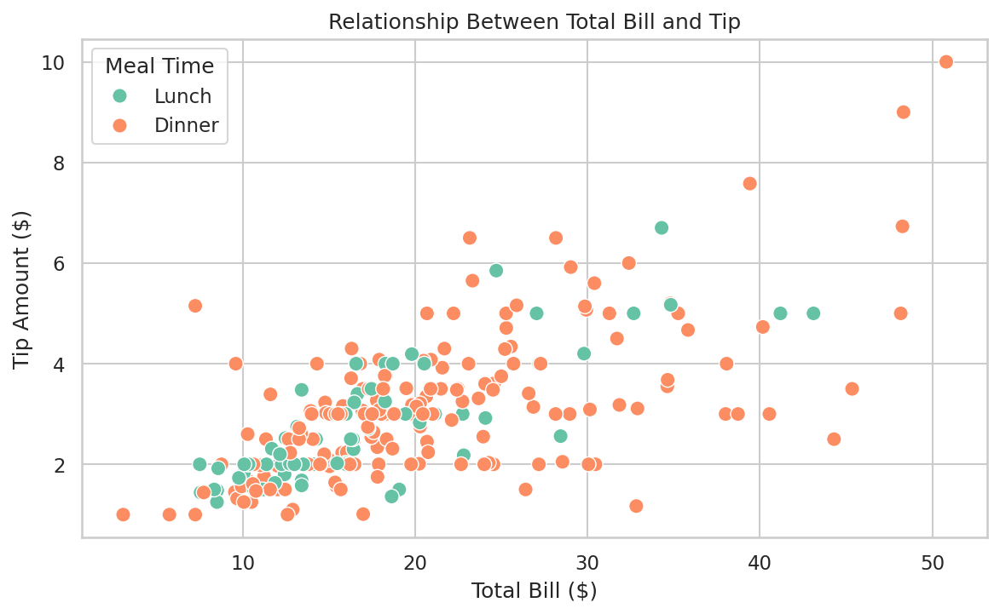
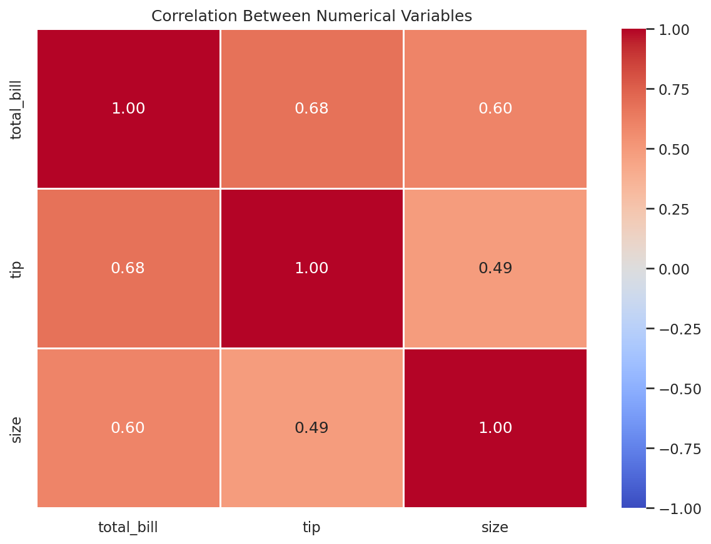

# Data Visualization with Matplotlib & Seaborn

## Project Overview
This project focuses on creating meaningful data visualizations using Python, Matplotlib, and Seaborn. The Tips dataset is used to explore restaurant bills, tips, customer counts, and their relationships.

## Technologies Used
- Python
- Pandas
- NumPy
- Matplotlib
- Seaborn
- Google Colab

## Dataset
- Dataset: Tips
- Total Records: 244
- Total Columns: 7

## Visualizations Created
1. Histogram – Distribution of total bills.
2. Box Plot – Tip distribution across different days.
3. Bar Chart – Average tip amount by day.
4. Scatter Plot – Relationship between total bill and tip.
5. Correlation Heatmap – Relationships between numerical variables.
6. Dashboard – Combined visualization of four charts.

## Key Findings
- Most restaurant bills are concentrated in the lower-to-middle price ranges.
- Tip amounts vary across different days.
- Sunday has the highest average tip, while Friday has the lowest.
- Higher total bills generally tend to be associated with higher tips.
- Total bill and tip have a positive correlation of 0.68.

## Dashboard

## Individual Charts

### Histogram

### Box Plot

### Bar Chart

### Scatter Plot

### Correlation Heatmap

## Conclusion
This project helped me understand how to choose suitable charts, customize visualizations, analyze relationships between variables, and communicate findings through data visualization.

## Author
Jothi A

## Internship
InternCirlce Data Science & AI Internship

Project 02: Data Visualization with Matplotlib & Seaborn
